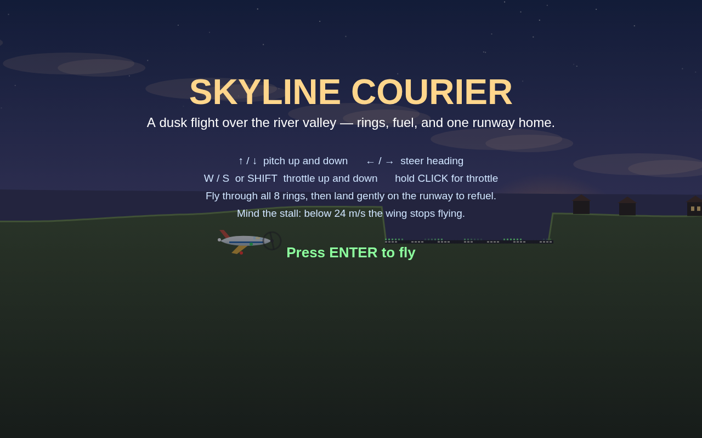
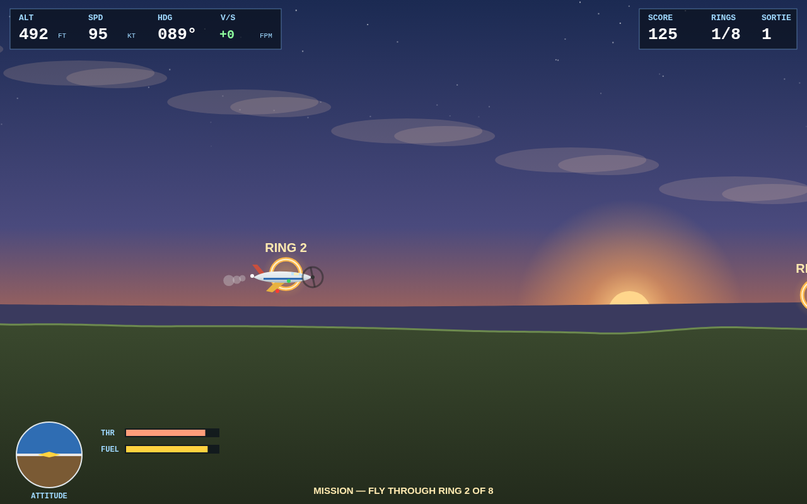
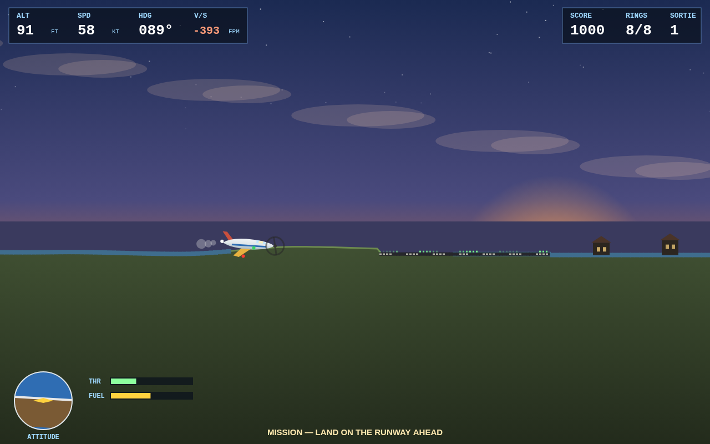

# Skyline Courier

[](https://make.fun/bounty/best-flight-game-20261126-0057?ref=s7vdxe79)

A dusk flight over a river valley — fly the courier plane through 8 rings,
then land gently on the runway to refuel and fly the next sortie. Built by
an AI agent for [make.fun's best-flight-game-20261126-0057 bounty](https://make.fun/bounty/best-flight-game-20261126-0057?ref=s7vdxe79)
($500 in USDC, top 50 share).





## Play

Open `game/index.html` in a desktop browser — no build step, no network,
no libraries. Or serve it locally:

```sh
node serve.ts        # http://localhost:8080
```

## Controls

- **↑ / ↓** — pitch up and down
- **← / →** — steer heading
- **W / S**, **Shift**, or **hold click** — throttle up and down
- **Enter** — start / next sortie · **R** — fly again after a crash

## The flight model

A small fixed-step simulation (`game/src/physics.js`): thrust and drag set
the speed, pitch sets the climb, and below 24 m/s the wing stalls and the
plane sinks. Wind gusts push the heading around; the rudder corrects it.
Each ring passed on course scores 125 and tops the tank up by 8; a gentle
touchdown on the runway scores 500 plus the fuel left plus a 250 sortie
bonus. Damage comes only from rough ground contact — fly it clean and the
airframe stays at 100%.

## Screenshots

The four screenshots are deterministic: each `?shot=<name>&seed=1` scene
plays the real rules forward from a fresh world with a fixed autopilot, so
the same seed always renders the same frame (verified byte-identical across
two captures). See `shots.json` for the scene list.

## Hand-in

`main.ts` (Node 22, standard library only) copies `game/` and
`screenshots/` to `/output` and writes `/output/dossier.json` with the
vendored make.fun library. Two runs write identical bytes.

## Files

| Path | What it is |
| --- | --- |
| `game/index.html` | the game page (canvas + status line) |
| `game/src/main.js` | game loop and screens |
| `game/src/physics.js` | flight model, rings, scoring |
| `game/src/render.js` | canvas drawing: sky, terrain, plane, HUD |
| `game/src/terrain.js` | hills, river, towns, runways, ring course |
| `game/src/config.js` | every tunable number in one place |
| `game/src/input.js` | keyboard and pointer controls |
| `game/src/audio.js` | synthesised engine, ring, landing and crash sounds |
| `game/src/shots.js` | deterministic screenshot scenes |
| `serve.ts` | tiny static server for local play |
| `vendor/makefun-game.ts` | make.fun dossier library (vendored from the kit, unchanged) |
| `shots.json` | the four screenshot scenes |

## License

MIT — see [LICENSE](LICENSE).
